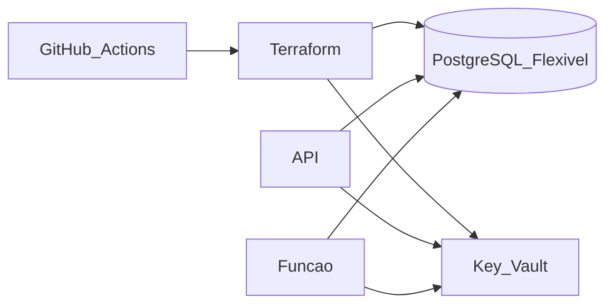

# WrenchBox — banco gerenciado

Terraform do PostgreSQL Flexible Server, do Key Vault e dos papéis `wrenchbox_app` e `wrenchbox_auth`.

## Tecnologias

- Terraform `hashicorp/azurerm` e `hashicorp/random`
- Azure Database for PostgreSQL Flexible Server 16
- Azure Key Vault com RBAC
- GitHub Actions e OIDC

## Arquitetura deste repositório



Um servidor, dois databases: `wrenchbox_homolog` e `wrenchbox_prod`. TLS obrigatório. O firewall aceita serviços Azure e, durante o apply, o IP do runner. As senhas não saem em output: ficam no Key Vault.

O papel `wrenchbox_app` cria e mantém o esquema (migrations da API). O papel `wrenchbox_auth` só lê as colunas de identidade do cliente, depois que a tabela `customers` existe. O script `scripts/create-roles.sh` pode ser executado de novo após a primeira subida da API para aplicar o `GRANT` de colunas.

## Execução

O primeiro apply é local e cria a conta de armazenamento do state:

```bash
terraform init -backend=false
terraform plan
terraform apply
```

Com o output `tfstate_storage_account`, migre o estado e use a mesma conta nos outros dois repositórios:

```bash
terraform init -migrate-state \
  -backend-config=resource_group_name=rg-wrenchbox \
  -backend-config=storage_account_name=sttfwbXXXXX \
  -backend-config=container_name=tfstate \
  -backend-config=key=wrenchbox-db.tfstate
```

Não há Dockerfile: este repositório não empacota processo.

## Deploy

Pull request roda `terraform validate` e `plan`. Push em `homolog` e em `main` faz `apply` do mesmo estado (os dois ambientes nascem juntos) e cria os papéis. Backend remoto deve ser configurado antes do primeiro apply compartilhado; o estado local não entra no git.

Segredos: `AZURE_CLIENT_ID`, `AZURE_TENANT_ID`, `AZURE_SUBSCRIPTION_ID`.

A collection e o Swagger continuam no repositório da API.

## Custo

SKU `B_Standard_B1ms` e 32 GB. Cabe no crédito Azure for Students. Separar servidores é a evolução descrita na ADR 006 da aplicação.
